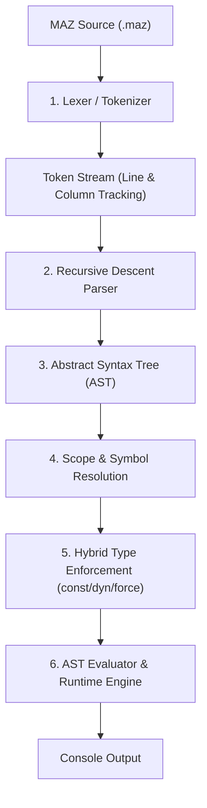

<p align="center">
  
</p>

<p align="center">
  <b>A modern, extensible, general-purpose programming language designed to grow.</b>
</p>

<p align="center">
  <a href="DIRECT_INSTRUCTIONS.md"><b>⚡ Direct Instructions (Skip theory & start coding)</b></a>
</p>

<p align="center">
  <a href="src/"></a>
  <a href="docs/CHANGELOG.md"></a>
  <a href="LICENSE"></a>
  <a href="docs/ARCHITECTURE.md"></a>
</p>

MAZ combines the rapid readability and approachable syntax of Python and modern JavaScript with the low-level capability, determinism, and performance of C++. 

Engineered as a long-term **evolving programming language project**, MAZ is designed to grow over time into a unified ecosystem spanning general application software, full-stack web, AI/ML, game engines, robotics, and embedded microcontrollers (such as Arduino and ESP32).

---

## 🌟 Key Language Highlights (MAZ 0.1)

```maz
// 1. Python-style type inference (no 'let' needed) & Constants
name = "Antigravity"
version = 0.1
const PI = 3.14159

// 2. Hybrid Type System: 'dyn' and 'force'
dyn dynamicVal = 100       // Opts into dynamic typing
dynamicVal = "now a string" // Valid

score = 95                 // Inferred as int
force score = "Grade: A+"  // Explicit type mutation via 'force'

// 3. Built-in Standard Output
display("Welcome to " + name + " v" + version)

// 4. Three-Part Loop with Commas & 'new' Scoping (Rule 7)
// 'new' creates a loop-local variable that shadows outer scopes
for (new i = 1, i <= 5, i++) {
    display("Iteration: " + i)
}

// 5. Functions with Inferred Return Types & Default Parameters
def calculateTotal(price, taxRate = 0.05) {
    return price + (price * taxRate)
}

total = calculateTotal(100.0)
display("Total price: " + total)
```

---

## 🚀 Quick Start & 1-Click Setup

For anyone on Windows, just double-click **`RUN_ME.bat`** (or run `.\setup.ps1` in PowerShell).  
It automatically:
- Builds the `maz.exe` compiler
- Adds `maz` to your system PATH so it works everywhere
- Installs the VS Code & Antigravity extensions
- Activates the custom MAZ file icons

---

### Manual Build Instructions (If not using RUN_ME.bat)
Using PowerShell:
```powershell
.\build.ps1
```
Or using Windows Command Prompt:
```cmd
build.bat
```
Or using GCC (g++) directly:
```bash
g++ -std=c++20 -O2 -I src src/lexer/Lexer.cpp src/parser/Parser.cpp src/runtime/Environment.cpp src/runtime/Interpreter.cpp src/main.cpp -o maz.exe
```

### 2. Run Example Programs
```bash
.\maz.exe run examples/01_hello.maz
.\maz.exe run examples/02_hybrid_types.maz
.\maz.exe run examples/03_conditions_and_math.maz
.\maz.exe run examples/04_loops.maz
.\maz.exe run examples/05_functions.maz
```

### 3. Interactive REPL
```bash
.\maz.exe repl
```

---

## 🌐 Using MAZ Globally Across Your Computer

By default, `maz.exe` runs inside its folder. You can make `maz` a **system-wide global command** (just like `python` or `node`) to run `.maz` files from **any folder, Desktop, or project** on your PC.

### Method 1: One-line PowerShell Setup (Recommended)
Run this command from inside the `maz` folder in PowerShell:
```powershell
[Environment]::SetEnvironmentVariable("Path", [Environment]::GetEnvironmentVariable("Path", "User") + ";$((Get-Location).Path)", "User")
```
*Restart your terminal or VS Code, and `maz` will be available globally!*

### Method 2: Windows System Settings (GUI)
1. Press the **Windows Key**, type **"env"**, and select **"Edit the system environment variables"**.
2. Click **Environment Variables...**.
3. Under *User variables*, select **`Path`** and click **Edit...**.
4. Click **New** and paste the path to your `maz` folder.
5. Click **OK** on all dialogs and restart your terminal.

Now you can run MAZ anywhere:
```bash
maz run my_script.maz
maz repl
maz --version
```

---

## 💻 Using MAZ in Visual Studio Code

### 1. Quick Keyboard Shortcut (`Ctrl + Shift + B`)
This repository includes configured `.vscode/tasks.json`.
- Open any `.maz` file in VS Code.
- Press **`Ctrl + Shift + B`** (or select **Terminal** → **Run Build Task...**).
- Your MAZ file will execute immediately in the built-in terminal.

### 2. Code Runner Extension Support
If you have the **Code Runner** extension installed:
- Click the **Play (▶)** button in the top-right corner of any `.maz` file or press **`Ctrl + Alt + N`**.
- It will automatically execute using `maz.exe run <filename>`.

### 3. Custom Syntax Highlighting
We provide a dedicated VS Code extension located in [`tools/vscode-extension/`](tools/vscode-extension/) for full keyword highlighting (`def`, `dyn`, `force`, `const`, `display`, etc.).
To install it into your VS Code:
```powershell
Copy-Item -Recurse "tools\vscode-extension" "$env:USERPROFILE\.vscode\extensions\maz-language-support"
```
Restart VS Code to enjoy full custom MAZ syntax highlighting!

---

## 🏗️ Compiler Architecture

MAZ is engineered in modular, independently testable stages:



- **Lexer:** Scans UTF-8 code, generates tokens with source location tracking, skips whitespace/comments (`//`, `/* */`), and resolves semicolonless statements across newlines.
- **Parser:** Predictive recursive descent parser with Pratt precedence parsing. Implements three-part loops with comma clause separators (`for (new i = 0, i < 10, i++)`).
- **AST:** Strongly-typed expression and statement node hierarchy utilizing the Visitor pattern.
- **Runtime Environment:** Lexical scope hierarchy, symbol table, variable shadowing (`new`), constant protection, dynamic types (`dyn`), and explicit type re-binding (`force`).
- **Diagnostic Engine:** Emits beginner-friendly compiler and runtime errors with source line previews and column caret pointers (`^`).

---

## 🧪 Automated Test Suite

MAZ includes a built-in automated test suite verifying syntax, loops, closures, recursion, and error diagnostics:

```powershell
powershell -ExecutionPolicy Bypass -File tests/run_tests.ps1
```

```
========================================
 Running MAZ Automated Test Suite 
========================================
Testing 01_hello.maz...               [PASS]
Testing 02_hybrid_types.maz...        [PASS]
Testing 03_conditions_and_math.maz... [PASS]
Testing 04_loops.maz...               [PASS]
Testing 05_functions.maz...           [PASS]
----------------------------------------
Results: 5 / 5 passed.
```

---

## 📚 Comprehensive Documentation

The language design and architecture are thoroughly documented in the `docs/` directory:

| Document | Purpose |
|---|---|
| [**Language Specification**](docs/LANGUAGE_SPEC.md) | Complete grammar, syntax rules, and type system semantics |
| [**Compiler Architecture**](docs/ARCHITECTURE.md) | Pipeline specifications from AST Evaluator to Bytecode VM & LLVM |
| [**Design Decisions & Solutions**](docs/DECISIONS.md) | Rationale for all 72 initial design rules and resolved ambiguities |
| [**Development Roadmap**](docs/ROADMAP.md) | Multi-version milestones (v0.1 to v0.6+ specialized domains) |
| [**Feature Implementation Tracker**](docs/FEATURES.md) | Active status of implemented, planned, and experimental features |
| [**Library Ecosystem**](docs/LIBRARIES.md) | Namespace layout (`maz.web`, `maz.ai`, `maz.arduino`, `maz.game`, etc.) |
| [**Changelog**](docs/CHANGELOG.md) | Version-by-version release log |
| [**Contributing Guide**](docs/CONTRIBUTING.md) | Guidelines for contributing and extending MAZ |

---

## 🗺️ Roadmap & Next Steps

- [x] **MAZ 0.1 — Foundation (Current):** Lexer, parser, variables, hybrid types (`dyn`/`force`), math, conditions, loops with commas/`new`, functions with default arguments, rich diagnostics, REPL.
- [ ] **MAZ 0.2 — Core Language:** Arrays (`pushback`), OOP (`class`, `struct`, `constructor`, `public`/`private`/`protected`), mixins (`include`), inheritance (`extends`), modules (`use`), exception handling (`try`/`catch`).
- [ ] **MAZ 0.3 — Advanced Systems:** Generics, pointers (`*`, `&`), memory ownership, async/await, native threads, C/C++ FFI.
- [ ] **MAZ 0.4 — Virtual Machine:** Bytecode compiler, stack VM, interactive terminal debugger, package manager (`maz install`).
- [ ] **MAZ 0.5 — Native Compilation:** LLVM backend for native standalone binaries, JIT compiler.
- [ ] **MAZ 0.6+ — Domain Ecosystems:** Native Arduino & ESP32 target without external libs, WebAssembly & fullstack web (`maz.web`), AI/ML tensor engine (`maz.ai`), and 2D/3D game development (`maz.game`).
