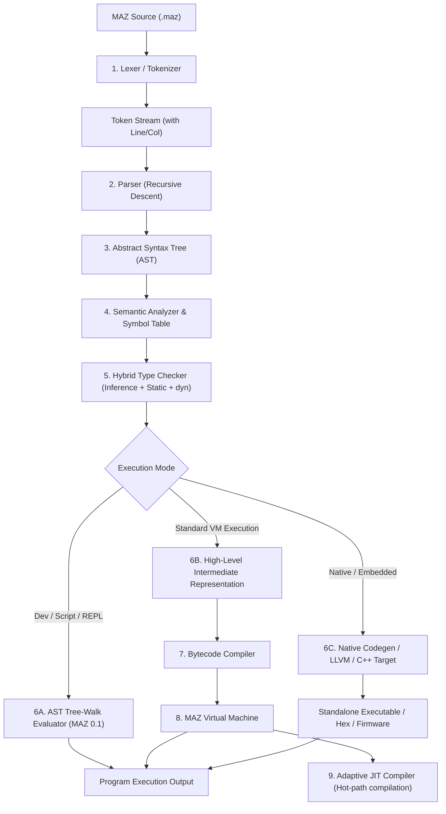

# MAZ Architecture Specification
**Document Version:** 1.0.0  
**Target Systems:** Windows, Linux, macOS, WebAssembly, Microcontrollers (Arduino/ESP32)  

---

## 1. System Overview

MAZ is engineered as a multi-stage, modular compilation and execution pipeline. The design separates frontend analysis (syntax and semantics) from backend execution targets (AST Tree-Walk Interpreter, Stack Bytecode Virtual Machine, and LLVM/Native Machine Code generation).

---

## 2. Compilation Stages

### Stage 1: Lexical Analysis (Lexer)
- **Role:** Converts raw source code strings into a stream of structured `Token` objects.
- **Responsibilities:**
  - Tracks character offsets, line numbers, and column numbers for precise diagnostic errors.
  - Recognizes identifiers, keywords (`def`, `const`, `dyn`, `force`, `new`, `if`, etc.), and literals (`int`, `float`, `string`, `bool`, `null`).
  - Distinguishes single-line comments `//`, multi-line comments `/* ... */`, and doc-comments `///`.
  - Handles automatic statement termination based on newline context.

### Stage 2: Syntactic Analysis (Parser)
- **Role:** Transforms the linear token stream into an Abstract Syntax Tree (AST).
- **Design Pattern:** Predictive Recursive Descent parser with Pratt parsing for operator precedence.
- **Key Syntax Rules:**
  - Semicolonless statement parsing.
  - C++ style conditional constructs `if (cond) { ... }`.
  - Three-part loops with comma clause separators: `for (clause1, clause2, clause3) { ... }`.
  - Function declarations: `def name(param1 = default, ...) { ... }`.
  - Type annotations and modifiers: `type?`, `dyn`, `force`.

### Stage 3: Abstract Syntax Tree (AST)
- **Role:** Strongly-typed representation of the program structure.
- **Node Categories:**
  - **Statements (`Stmt`):** `VarDeclStmt`, `AssignmentStmt`, `IfStmt`, `ForStmt`, `WhileStmt`, `FunctionStmt`, `ReturnStmt`, `BlockStmt`, `ExpressionStmt`, `TryCatchStmt`, `ClassStmt`.
  - **Expressions (`Expr`):** `LiteralExpr`, `VariableExpr`, `BinaryExpr`, `UnaryExpr`, `CallExpr`, `ArrayExpr`, `MemberExpr`, `AssignExpr`.

### Stage 4: Semantic Analysis & Symbol Resolution
- **Role:** Validates scope boundaries, symbol declarations, variable shadowing (`new`), and identifier availability.
- **Scope Hierarchy:**
  - Global / Module Scope
  - Class / Struct Scope
  - Function Scope
  - Block Scope (Loop, conditional, local block)

### Stage 5: Hybrid Type Checking
- **Role:** Performs static type verification and runtime dynamic tracking.
- **Rules:**
  - Infers types upon first assignment.
  - Checks type consistency on reassignment unless `force` is supplied.
  - `dyn` variables bypass static restrictions.
  - Ensures non-nullable types are never assigned `null`.

### Stage 6: Execution Targets

#### A. Direct Tree-Walk Interpreter (Foundation Stage - MAZ 0.1)
- Evaluates AST nodes directly in memory using an `Environment` scope chain.
- Provides immediate developer feedback, zero compilation delay, and an interactive REPL.

#### B. Bytecode Virtual Machine (MAZ 0.4)
- Compiles AST to compact, linear bytecode instructions (`OP_PUSH`, `OP_ADD`, `OP_JUMP_IF_FALSE`, `OP_CALL`).
- Fast virtual CPU execution with stack-allocated frames and register optimizations.

#### C. Native & Embedded Compilation (MAZ 0.5+)
- Compiles MAZ directly to native machine code via LLVM or generates optimized C++ code for embedded targets (Arduino AVR, ESP32, ARM Cortex).

---

## 3. Runtime Environment & Memory Management

### Memory Architecture
1. **Value Representation:**
   - In MAZ 0.1, values are represented by a polymorphic `Value` struct (using `std::variant` in C++20) supporting integer, float, string, boolean, null, functions, and arrays.
   - In MAZ 0.4+, the VM uses NaN-tagging or 16-byte packed value descriptors for extreme performance.
2. **Garbage Collection (Managed Mode):**
   - Tracing generational mark-and-sweep or reference counting with cycle detection for high-level objects.
3. **Manual / Embedded Mode:**
   - For microcontrollers (Arduino/ESP32) where memory is constrained (e.g. 2KB RAM on ATmega328P), MAZ compiles directly to static buffers and stack memory without requiring a full garbage collector runtime.

---

## 4. Diagnostics & Error System

Every compiler and runtime error contains:
- Source file path.
- Line and column number.
- Excerpt of the offending code snippet with caret pointer (`^`).
- Clear human-readable description of what went wrong and expected vs received types.
- Traceback of active call frames.

